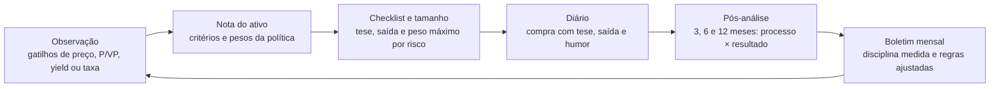

# Aditivo 1 ao SPEC.md: Mesa do investidor

**Data:** 15/10/2026
**Base:** SPEC.md exportado em 12/10/2026, com a política já ajustada para o lado conservador.

Este aditivo traz a Mesa do investidor, que adapta a disciplina das skills de trader a quem investe no longo prazo. Ele acrescenta os marcos 7, 8 e 9 e faz poucas mudanças no que já existe. Operações de curto prazo com dinheiro real continuam fora do app.

## Como aplicar

1. Leia o SPEC.md e depois este aditivo. Quando os dois divergirem, vale o aditivo.
2. Não refaça marcos concluídos. As mudanças no que já existe estão na seção 2 e são quase todas de valor padrão ou de texto.
3. A Mesa do investidor é construída nos marcos 7, 8 e 9, depois do marco 6, um de cada vez, com teste no iPhone ao fim de cada um.
4. Siga as regras de privacidade do SPEC.md: dados fictícios no desenvolvimento, nada da carteira fora do aparelho e nenhum dado pessoal no repositório.
5. Ao concluir o marco 7, incorpore este aditivo ao SPEC.md, para o repositório voltar a ter uma fonte só.

## 1. Resumo das mudanças

| Parte do SPEC | Mudança | Quando |
| --- | --- | --- |
| Decisões fechadas | Nova linha: Mesa do investidor | Agora |
| Política, Limites | Ação individual passa de 5% para 2,86% da carteira livre | Agora, como valor padrão |
| Fora do escopo | Entram análise técnica e curto prazo com dinheiro real; FIIs saem da lista | Agora |
| Mesa do investidor | Seção nova, entre "Motor de sugestões" e "Ponte com o Claude" | Marcos 7 a 9 |
| Modelo de dados | 7 entidades novas e campos novos em 3 entidades | Marco 7 |
| Telas | Passam a 12: entra a Mesa do investidor; mudam Política, Cenários e Revisão mensal | Marcos 7 a 9 |
| Ponte com o Claude | Sexta pergunta pronta, ficha do ativo e novos caminhos no ajuste de política | Marcos 7 e 8 |
| Dados de mercado | Volume da B3 e informe mensal dos FIIs da CVM | Marco 8 |
| Motor de sugestões, Aporte do mês | O passo 5 passa a indicar ativos elegíveis da lista de observação | Marco 8 |
| Marcos | Passam de 7 para 10 | Marcos 7 a 9 |
| Testes | 9 testes novos | Marcos 7 a 9 |
| Em aberto | 2 itens novos | Marco 8 em diante |

## 2. Mudanças no que já existe

### 2.1 Decisões fechadas

Nova linha na tabela:

| Tema | Decisão |
| --- | --- |
| Mesa do investidor | Disciplina de trader adaptada ao longo prazo: checklist de compra, tamanho por risco, nota do ativo, gatilhos, pós-análise, freios e modo treino. Sem operações de curto prazo com dinheiro real. |

### 2.2 Política, Limites

- **Antes:** Ação individual: no máximo 5% da carteira livre. O núcleo da classe é um ETF amplo.
- **Agora:** Ação individual: no máximo 2,86% da carteira livre, pelo orçamento de risco da Mesa do investidor. O núcleo da classe é um ETF amplo.

Até o marco 7, o valor entra como constante na política padrão. No marco 7, ele passa a sair da fórmula da seção 3.2, e a migração troca o limite antigo de 5% numa política já salva.

### 2.3 Fora do escopo

- **Antes:** Crédito privado sem FGC, opções, futuros e day trade.
- **Agora:** Crédito privado sem FGC, opções, futuros, análise técnica e operações de curto prazo com dinheiro real, como day trade e swing trade. O modo treino cobre a prática sem risco. Entre os brasileiros que começaram a fazer day trade no mercado futuro de índice entre 2013 e 2015 e persistiram por 300 dias ou mais, 97% perderam dinheiro.
- **Antes:** Indicadores fundamentalistas de ações e FIIs.
- **Agora:** Indicadores fundamentalistas automáticos de ações. Os FIIs ganham nota na Mesa do investidor.

### 2.4 Telas

São 12 telas. A Mesa do investidor entra entre Revisão mensal e Ferramentas, e três linhas mudam:

| Tela | O que mostra |
| --- | --- |
| Política | Meta da reserva, alvos e faixas, limites, choques dos cenários, termômetro, parâmetros fiscais, orçamento de risco, critérios da nota e limites dos freios |
| Cenários | Perda por cenário em reais e em percentual, a classe que mais pesa e o teste histórico da política |
| Revisão mensal | Checklist do mês, diário com revisões pendentes, teses por ativo e boletim de disciplina |
| Mesa do investidor (nova) | Lista de observação com gatilhos, nota do ativo, checklist de compra, calculadora de tamanho e modo treino |

### 2.5 Motor de sugestões, Aporte do mês, passo 5

- **Antes:** Dentro da classe, o motor indica o tipo de ativo: indexador em falta, ano vago na escada, emissor abaixo do limite.
- **Agora:** Dentro da classe, o motor indica o tipo de ativo: indexador em falta, ano vago na escada, emissor abaixo do limite e, na renda variável, ativos elegíveis da lista de observação.

### 2.6 Em aberto

Dois itens novos:

- [ ] Recalibrar os padrões da nota do ativo e dos freios no marco 8.
- [ ] Decidir, depois de 6 meses de modo treino, se vale criar uma fatia satélite com dinheiro real, de até 5% da carteira livre.

## 3. Seção nova: Mesa do investidor

Entra no SPEC.md entre "Motor de sugestões" e "Ponte com o Claude".

A Mesa traz a disciplina das skills de trader para quem investe no longo prazo: toda compra passa por observação, nota, checklist e tamanho máximo, e toda decisão volta para revisão. Operações de curto prazo com dinheiro real ficam de fora; para praticar, existe o modo treino.



A observação leva à nota; o checklist fixa a tese e o tamanho; o diário guarda a decisão; a pós-análise mede o processo; e o boletim ajusta as regras que alimentam a próxima observação.

### 3.1 De onde vem cada ideia

| Prática das skills de trader | Versão na Mesa |
| --- | --- |
| Arriscar no máximo 1% a 2% do capital por operação | Nenhum ativo pode custar mais de 2% da carteira livre numa queda severa |
| Definir o stop antes de entrar | Escrever, antes da compra, o que invalidaria a tese |
| Nota do setup, de 1 a 10 | Nota do ativo, de 0 a 10, com critérios e pesos editáveis |
| Relação mínima entre risco e retorno | Prêmio mínimo sobre o Tesouro, na renda fixa |
| Watchlist com níveis de entrada | Lista de observação com gatilhos |
| Diário e revisão de cada operação | Diário com pós-análise em 3, 6 e 12 meses |
| Psicologia e erros comuns | Freios de comportamento |
| Ler o regime do mercado antes de operar | Termômetro ampliado, com o P/VP dos FIIs |
| Backtest e paper trading | Teste histórico da política e modo treino |

### 3.2 Tamanho máximo por ativo

- **Orçamento de risco:** nenhum ativo pode custar mais de 2% da carteira livre.
- **Fórmula:** peso máximo = orçamento ÷ queda de referência do tipo de ativo.
- **Quedas de referência:** ação individual 70%, FII individual 50%, ETF setorial ou temático 50%. ETF amplo, renda fixa e cripto já são limitados pela classe e pelo FGC.
- **Resultado com os padrões:** ação individual 2,86% da carteira livre e ETF setorial 4%. Para FII individual a conta dá 4%, mas vale o limite da política: 25% da classe, ou 2% com o alvo de 8%.
- **Calculadora:** mostra quanto ainda cabe, ou seja, o peso máximo menos a posição atual, limitado pelo déficit da classe e pelo aporte do mês.

### 3.3 Nota do ativo

A nota vai de 0 a 10 e é a média ponderada de critérios que valem 0, 5 ou 10. Com 7 ou mais, o ativo é elegível; de 5 a 6,9, fica em observação; abaixo de 5, fica de fora. Elegível só quer dizer que o ativo pode receber aporte quando a classe estiver abaixo do alvo: a nota nunca diz "compre".

Critérios, pesos e faixas ficam editáveis na Política. Os padrões abaixo são um ponto de partida, a recalibrar no marco 8 com a distribuição real dos dados.

**FIIs**, com dados da CVM e da B3:

| Critério | Peso | Vale 10 | Vale 5 | Vale 0 |
| --- | --- | --- | --- | --- |
| Liquidez média diária, 21 pregões | 2 | R$ 1 milhão ou mais | R$ 300 mil a R$ 1 milhão | Menos de R$ 300 mil |
| Patrimônio líquido | 1 | R$ 1 bilhão ou mais | R$ 300 milhões a R$ 1 bilhão | Menos de R$ 300 milhões |
| Número de cotistas | 1 | 20 mil ou mais | 5 mil a 20 mil | Menos de 5 mil |
| P/VP | 1,5 | 0,85 a 1,05 | 0,75 a 0,85, ou 1,05 a 1,15 | Fora dessas faixas |
| Estabilidade dos rendimentos em 12 meses (desvio ÷ média) | 1,5 | Até 10% | 10% a 25% | Mais de 25% |
| Dividend yield de 12 meses ÷ mediana dos FIIs | 1 | 0,8 a 1,3 | 0,6 a 0,8, ou 1,3 a 1,6 | Fora dessas faixas |

P/VP muito baixo e yield muito alto pontuam menos de propósito: costumam indicar vacância, inadimplência ou rendimento que não se sustenta.

**ETFs**, com liquidez da B3 e taxa digitada pelo usuário:

| Critério | Peso | Vale 10 | Vale 5 | Vale 0 |
| --- | --- | --- | --- | --- |
| Liquidez média diária, 21 pregões | 2 | R$ 5 milhões ou mais | R$ 1 milhão a R$ 5 milhões | Menos de R$ 1 milhão |
| Taxa de administração ao ano | 2 | Até 0,30% | 0,30% a 0,60% | Mais de 0,60% |
| Tipo de índice | 1 | Amplo | Não se aplica | Setorial ou temático |

**Ações:** a primeira versão usa a ficha do ativo e a conversa com o Claude. A nota automática a partir dos balanços da CVM fica para depois.

**Renda fixa:** não tem nota. O checklist calcula o prêmio, líquido de IR, sobre o título do Tesouro de prazo e indexador parecidos, já descontada a custódia de 0,20% ao ano. O padrão pede 0,5 ponto percentual ao ano de prêmio para aplicações sem liquidez diária; na reserva vale o piso de 100% do CDI.

### 3.4 Checklist de compra

Antes de registrar uma compra de renda variável, ou uma aplicação de renda fixa sem liquidez diária, o app passa por oito perguntas:

1. **Papel na política:** classe e déficit atual. Se a classe já está acima do alvo, avisa que a compra aumenta um desvio.
2. **Tese:** em até três frases.
3. **Saída:** o que invalidaria a tese. É o stop de quem investe no longo prazo.
4. **Horizonte:** em anos.
5. **Tamanho:** dentro do peso máximo.
6. **Qualidade:** nota do ativo ou prêmio sobre o Tesouro.
7. **Execução:** custos, liquidez média diária e, quando a ordem pesa na liquidez do dia, a sugestão de ordem limitada.
8. **Humor:** calmo, animado, com medo ou com pressa. Serve à pós-análise.

O resultado é "liberado", "liberado com ressalvas" ou "recomendo esperar". O app nunca bloqueia: seguir em frente exige uma justificativa escrita, que vai para o diário como exceção.

### 3.5 Lista de observação

- Até 20 itens, cada um com ativo ou título do Tesouro, gatilho e validade.
- Gatilhos possíveis: preço até X, P/VP até X, dividend yield de 12 meses acima de X, taxa do título acima de X e nota mínima.
- O app confere os gatilhos ao abrir, com os dados do dia. Gatilho atingido leva ao checklist, nunca a uma ordem.
- Com dados de mais de 5 dias úteis, nenhum gatilho dispara.
- A lista fica só no aparelho. Como a rotina publica o mercado inteiro, observar um ativo não revela nada.

### 3.6 Diário com pós-análise

- Toda compra e venda guarda tese, saída, horizonte, nota, resultado do checklist, exceções e humor.
- Revisões automáticas em 3, 6 e 12 meses perguntam se a tese continua de pé. O app mostra o retorno contra o referencial da classe: CDI na renda fixa, ETFs de índice da B3 na renda variável (a escolha de cada um fica para o marco 8) e bitcoin em cripto.
- Cada decisão revisada entra num quadro de processo × resultado. Processo bom é checklist seguido, dentro dos limites e sem freio ignorado. Processo bom com resultado ruim é azar; processo ruim com resultado bom é sorte, e não deve virar hábito.
- O boletim mensal mostra a parcela de compras que passou pelo checklist, as exceções, as vendas fora do plano, o desvio total da política e o resultado por humor declarado.

### 3.7 Freios de comportamento

Os freios perguntam e registram; nenhum bloqueia. Os limites ficam editáveis.

| Situação | O que o app faz |
| --- | --- |
| Compra de ativo que subiu mais de 30% em 3 meses | Pergunta o que mudou além do preço |
| Nova compra de ativo que caiu mais de 20% desde a primeira compra | Pede a revisão da tese antes |
| Venda de ativo ou classe que caiu mais de 15% no mês | Aplica a espera de 72 horas e mostra o cenário que já previa a queda |
| Mais de 4 operações de renda variável no mês | Alerta de excesso de giro |
| 3 decisões seguidas com processo ruim | Sugere 30 dias sem posições novas |
| Carteira livre caindo mais que o pior cenário testado | Congela mudanças de política por 30 dias e sugere uma revisão com o Claude |

### 3.8 Termômetro ampliado

- Além das taxas do Tesouro, acompanha o P/VP mediano dos FIIs, calculado com dados da CVM e da B3, e o percentil dele desde 2016.
- Percentil 25 ou menos desloca o alvo de FIIs meia faixa para cima; percentil 75 ou mais, meia faixa para baixo. A diferença sai da renda fixa pós-fixada, ou volta para ela.
- Com todos os deslocamentos para cima ao mesmo tempo, o pior cenário vai a 19,26%, ainda dentro do limite de 20%.
- Pode ser desligado na Política.

### 3.9 Modo treino

- Carteira simulada com dinheiro fictício, R$ 10 mil por padrão, separada da carteira real e marcada como treino em todas as telas.
- Usa preços de fechamento e simula custos e IR: 15% em ações e ETFs, 20% em FIIs e isenção para vendas de ações de até R$ 20 mil no mês.
- Serve para testar estratégias, inclusive de curto prazo, sem arriscar dinheiro. Day trade não cabe, porque os dados são diários.
- A cada trimestre, um relatório compara o treino com a política e com o CDI, operação por operação.

### 3.10 Teste histórico da política

- Simula a política mês a mês, com aportes e rebalanceamento pelos aportes, no período em que houver dados de todas as classes.
- Usa CDI e IPCA do Banco Central, preços históricos do Tesouro Direto e ETFs de índice da B3. A rotina registra o início de cada série, e classe sem série no período aparece como "série curta".
- Mostra a pior queda real, o tempo de recuperação e o retorno real ao ano, contra 100% do CDI.
- Passado não garante futuro: o teste complementa os cenários, não os substitui.

### 3.11 Definições de cálculo

- **Nota:** soma de peso × pontos ÷ soma dos pesos. Critério sem dado sai das duas somas e a nota aparece como parcial; se o peso disponível for menos da metade do total, o ativo fica sem nota.
- **Liquidez média diária:** média do volume financeiro dos últimos 21 pregões.
- **P/VP:** preço de fechamento ÷ valor patrimonial da cota no último informe mensal.
- **Dividend yield de 12 meses:** rendimentos por cota dos últimos 12 meses ÷ preço de fechamento.
- **Mediana dos FIIs:** calculada entre os FIIs com liquidez média de pelo menos R$ 300 mil por dia.
- **Estabilidade dos rendimentos:** desvio padrão ÷ média dos rendimentos mensais por cota dos últimos 12 meses.
- **Termômetro dos FIIs:** mediana mensal do P/VP desses FIIs; o percentil compara o valor atual com a série desde 2016.
- **Variações dos freios:** pelo preço de fechamento; 1 mês = 21 pregões e 3 meses = 63 pregões.
- **Queda da carteira livre:** distância até o maior valor já atingido, medida por um índice de cotas que desconta aportes e resgates.
- **Retorno na pós-análise:** preço mais proventos, contra o referencial no mesmo período.
- **Processo ruim:** checklist ignorado, compra acima do peso máximo ou freio ignorado.

## 4. Modelo de dados

Entidades novas:

| Entidade | Campos principais |
| --- | --- |
| `WatchItem` | `assetRef`, `triggers[]` (`kind`, `threshold`), `minScore`, `expiresAt`, `note` |
| `AssetScore` | `assetRef`, `asOf`, `rubricVersion`, `criteria[]`, `total`, `verdict` |
| `PurchaseChecklist` | `date`, `assetRef`, `answers`, `result`, `override`, `decisionLogId` |
| `DecisionReview` | `decisionLogId`, `dueDate`, `thesisHolds`, `returnPct`, `benchmarkPct`, `processQuality`, `outcome` |
| `BehaviorEvent` | `date`, `rule`, `assetRef`, `userAction` |
| `PaperPortfolio` | `startedAt`, `cash`, `positions[]`, `transactions[]`, `costs` |
| `BacktestRun` | `runAt`, `period`, `seriesStart`, `maxDrawdown`, `recoveryMonths`, `realReturn` |

Campos novos em entidades que já existem:

| Entidade | Campos novos |
| --- | --- |
| `Policy` | `riskBudgetPerAsset`, `referenceDrops`, `scoreRubrics`, `behaviorThresholds`, `fiiTiltEnabled` |
| `DecisionLog` | `thesis`, `exitCondition`, `horizonYears`, `mood`, `checklistId` |
| `MarketSnapshot` | `fiis`, `benchmarks` |

A migração entra no marco 7 e cria tudo de uma vez. O `PaperPortfolio` fica em tabela própria, sem chave em comum com a carteira real.

## 5. Dados de mercado

| Dado | Fonte | Arquivo publicado | Situação |
| --- | --- | --- | --- |
| Fechamento e volume de ações, FIIs, ETFs e BDRs | [Cotações históricas da B3](https://www.b3.com.br/pt_br/market-data-e-indices/servicos-de-dados/market-data/historico/mercado-a-vista/cotacoes-historicas/) (arquivo COTAHIST) | `b3.json` | Se o arquivo ainda não traz o volume, o marco 8 acrescenta |
| Informe mensal dos FIIs: valor patrimonial da cota, cotistas e rendimentos | [Dados abertos da CVM](https://dados.cvm.gov.br/dataset/fii-doc-inf_mensal), atualização semanal, histórico desde 2016, licença ODbL | `fiis.json` | Validar no marco 8, com as colunas e a ligação entre CNPJ e ticker |

- **Arquivos da CVM:** `https://dados.cvm.gov.br/dados/FII/DOC/INF_MENSAL/DADOS/inf_mensal_fii_{ANO}.zip`, com o dicionário de dados em `https://dados.cvm.gov.br/dados/FII/DOC/INF_MENSAL/META/meta_inf_mensal_fii.zip`.
- **Termômetro:** `thermometer.json` ganha a série mensal do P/VP mediano dos FIIs e o percentil atual.
- **Referenciais:** os da renda variável saem de `b3.json`. A escolha dos ETFs de índice fica para o marco 8.
- **Privacidade:** a rotina publica todos os FIIs, nunca só os da lista de observação.

## 6. Ponte com o Claude

- **Perguntas prontas:** passam a seis, com "revisar uma decisão passada". Ela copia o resumo e, em texto, o registro da decisão: data, ativo, tese, saída, humor, nota da época e retornos do ativo e do referencial, em percentuais.
- **Ficha do ativo:** gerada pelo botão "Pedir análise ao Claude". Traz a nota, as métricas públicas do ativo, o peso atual e o máximo em percentuais e o rascunho da tese, sem valores em reais. A decisão continua sendo registrada no app, pelo checklist.
- **Formato fixo:** a ficha segue o formato que a skill do consultor espera. Mudar nomes de campos exige atualizar a skill.

O formato é este, com números ilustrativos:

```json
{
  "type": "FICHA-ATIVO",
  "version": 1,
  "asOf": "2026-11-03",
  "marketDataAsOf": "2026-10-30",
  "asset": { "ticker": "XXXX11", "class": "fiis", "segment": "logística" },
  "score": {
    "total": 7.5,
    "verdict": "elegivel",
    "rubricVersion": 1,
    "criteria": [{ "name": "liquidez", "value": 2100000, "points": 10, "weight": 2 }]
  },
  "metrics": { "pvp": 0.93, "dy12m": 10.8, "dy12mMedianaFiis": 11.2, "cotistas": 85000 },
  "position": { "pesoAtual": 1.2, "pesoMaximo": 2.0, "deficitDaClasse": 0.8 },
  "draft": { "thesis": "tese em até três frases", "exitCondition": "o que invalidaria a tese", "horizonYears": 5 },
  "flags": ["alta-30pct-3m"]
}
```

- **Ajuste de política:** o bloco `AJUSTE-POLITICA` passa a aceitar também `riskBudgetPerAsset`, `referenceDrops.acaoIndividual`, `referenceDrops.fiiIndividual`, `referenceDrops.etfSetorial` e `fiiTiltEnabled`.

## 7. Marcos 7 a 9

Os marcos 0 a 6 não mudam. O SPEC passa a ter dez marcos, e os três novos só começam com o app básico pronto.

| Marco | Entrega | Aceite |
| --- | --- | --- |
| 7. Mesa: disciplina | Checklist de compra, tamanho máximo, diário com pós-análise, freios de comportamento e boletim de disciplina | Casos de referência do tamanho e dos freios passam, e uma compra com checklist ignorado aparece como exceção no boletim |
| 8. Mesa: dados e nota | Informe mensal dos FIIs na rotina de dados, nota de FIIs e ETFs, lista de observação, termômetro ampliado e ficha do ativo para o Claude | Notas batem com os casos de referência e gatilho com dado velho não dispara |
| 9. Mesa: treino e histórico | Modo treino e teste histórico da política | O treino nunca se mistura com a carteira real e o teste reproduz um caso calculado à mão |

O que entra em cada marco:

- **Marco 7:** migração do modelo de dados; seções 3.2 (tamanho), 3.4 (checklist), 3.6 (diário e pós-análise) e 3.7 (freios), com o boletim; pergunta pronta "revisar uma decisão passada"; caminhos `riskBudgetPerAsset` e `referenceDrops.*` no ajuste de política; telas Mesa do investidor (checklist e calculadora), Revisão mensal e Política (orçamento e freios). Até o marco 8, a pós-análise da renda variável mostra só o retorno do ativo.
- **Marco 8:** informe da CVM e volume da B3 na rotina de dados; seções 3.3 (nota), 3.5 (lista de observação) e 3.8 (termômetro ampliado); referenciais da renda variável; ficha do ativo; caminho `fiiTiltEnabled`; passo 5 do aporte; recalibração dos padrões da nota e dos freios.
- **Marco 9:** seções 3.9 (modo treino) e 3.10 (teste histórico), com a aba Histórico na tela Cenários.

## 8. Testes novos

- Peso máximo: ação individual em 2,86% e FII individual limitado a 2%, com os padrões.
- Nota do ativo: um FII e um ETF fictícios com nota calculada à mão.
- Nota parcial: critério sem dado sai da conta, e menos da metade do peso deixa o ativo sem nota.
- Gatilhos: cada tipo dispara com o dado do dia, e nenhum dispara com dado velho.
- Freios: cada regra dispara no caso de referência e registra a ação do usuário.
- Pós-análise: retorno contra o referencial e classificação de processo × resultado.
- Ficha do ativo: sai sem valores em reais da carteira e com os nomes de campo do formato.
- Modo treino: IR simulado na venda e nenhuma operação vazando para a carteira real.
- Termômetro ampliado: percentil do P/VP mediano e pior cenário de 19,26% com todos os deslocamentos para cima.

## 9. Fontes

Páginas abertas entre 10 e 15 de outubro de 2026.

- [Trader, de ivangdavila, no ClawHub](https://clawhub.ai/ivangdavila/trader)
- [Trader, de adamlevoy, no MCP Market](https://mcpmarket.com/tools/skills/trader)
- [Claude Trading Skills, de tradermonty](https://github.com/tradermonty/claude-trading-skills)
- [Informe mensal dos FIIs, dados abertos da CVM](https://dados.cvm.gov.br/dataset/fii-doc-inf_mensal)
- [Day trading for a living?, Chague, De-Losso e Giovannetti, FGV EESP, 2020](https://econpapers.repec.org/RePEc:fgv:eesptd:525)
